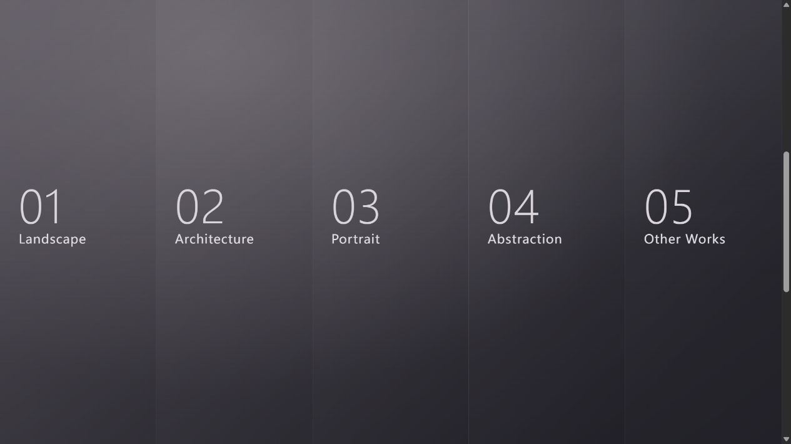

# Closer Look

A fullscreen photography and motion portfolio built with HTML, CSS and JavaScript.

The desktop gallery uses tall covers that reveal on hover or keyboard focus. Each cover has its own crop so a narrow column still frames the subject. The touch layout stacks the bookmarks vertically. The first tap wipes a photograph across the entire bookmark and shows an explicit way to enter the series. Each horizontal cover has its own focal point to keep its subject in the frame.

Inside each series, use the arrows or scroll to move through the photographs. The page counter follows your position, and closing the gallery returns focus to the bookmark. The interface respects reduced-motion preferences.

Open [index.html](index.html) in a browser to run the gallery. The public demo uses abstract covers and a motion poster. No dependencies or build step are required.

The gradient and lens concept draws inspiration from [Purrweb's portfolio study](https://dribbble.com/shots/19871911-Landing-Designer-portfolio).
